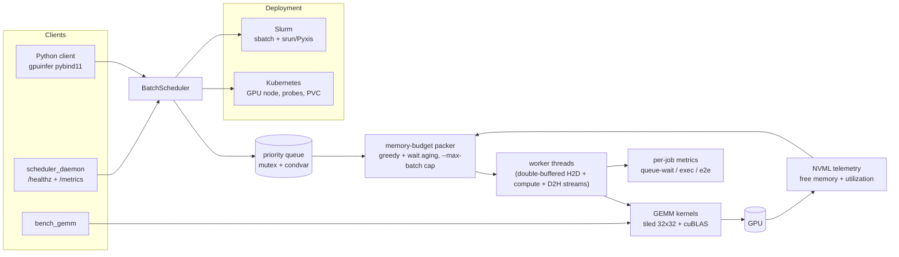
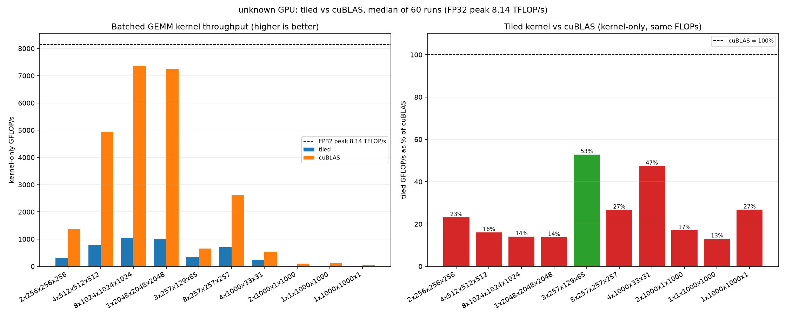

# gpu-batch-inference-scheduler

A GPU batch-inference scheduler in C++17/CUDA. Clients submit GEMM "inference
jobs" (`C[b] = A[b] * B[b]`); a thread-safe priority queue feeds a
memory-budget packer that executes batches on dedicated CUDA streams.
Waiting-time aging keeps large jobs from starving. The repo ships native
binaries, a pybind11 module (`gpuinfer`), NVML telemetry, `/metrics`, and
Docker/Kubernetes/Slurm manifests.

**Hardware:** Tesla T4 (sm_75), NVIDIA driver 580.82.07, CUDA 13.0; FP32 peak used 8.1408 TFLOP/s (`results/hardware.txt`).



## Results

GEMM timings are kernel-only medians from 10 warmup + 60 timed runs measured
with cudaEvents; full data, including end-to-end transfers and percent-of-peak,
is in `results/benchmark.csv`. Scheduler runs are in
`results/scheduler_stress.csv`; the saturation sweep is in
`results/saturation/summary.csv`. Profiling numbers are in
`docs/PROFILING.md`.

### Tiled vs cuBLAS

cuBLAS is the GPU baseline. The tiled kernel is a simple 32×32×32
shared-memory SGEMM; the table shows how far it is from cuBLAS, not just how
far both are from the CPU.

| Shape (B × M × N × K) | tiled kernel ms | cuBLAS kernel ms | tiled % of cuBLAS | tiled / cuBLAS GFLOP/s |
|---|---:|---:|---:|---:|
| 2 × 256 × 256 × 256 | 0.210 | 0.049 | 23.2% | 319 / 1378 |
| 4 × 512 × 512 × 512 | 1.353 | 0.217 | 16.1% | 793 / 4937 |
| 8 × 1024 × 1024 × 1024 | 16.514 | 2.333 | 14.1% | 1040 / 7365 |
| 1 × 2048 × 2048 × 2048 | 17.125 | 2.368 | 13.8% | 1003 / 7254 |
| 3 × 257 × 129 × 65 | 0.037 | 0.020 | 52.9% | 345 / 653 |
| 8 × 257 × 257 × 257 | 0.388 | 0.104 | 26.7% | 700 / 2620 |
| 4 × 1000 × 33 × 31 | 0.033 | 0.016 | 47.4% | 247 / 520 |
| 2 × 1000 × 1 × 1000 | 0.225 | 0.038 | 17.0% | 18 / 105 |
| 1 × 1 × 1000 × 1000 | 0.116 | 0.015 | 13.0% | 17 / 132 |
| 1 × 1000 × 1000 × 1 | 0.111 | 0.030 | 26.7% | 18 / 68 |

On the four README shapes tiled is **14–23% of cuBLAS**; on the large shapes
it reaches 12–13% of T4 FP32 peak while cuBLAS reaches ~89–90%. Skinny
matrices are worse: tiled falls to 13–27% of cuBLAS because a 32-wide tile
wastes most of its lanes. The CPU baseline (NumPy/OpenBLAS, 2 threads on
2 vCPU) and speedups are in `results/benchmark.csv`; this table focuses on the
GPU-vs-GPU comparison.



### Scheduler

| Workload | Result |
|---|---|
| 1000 jobs at 20 jobs/s, 2 workers | **19.36 jobs/s**; p50/p95/p99 **33.6 / 135.8 / 188.9 ms**; 11.7% mean NVML utilization; **0 failed** |
| 1000 jobs, saturated backlog, 2 workers | **45.35 jobs/s**; p50/p95/p99 **4.32 / 18.36 / 21.38 s**; 24.0% mean NVML utilization; 1000/1000 completed |
| 6.63× GPU memory queued | 99.5 GiB queued on a 15.0 GiB GPU; 2 oversized jobs rejected cleanly; 998 executed; **0 cudaMalloc failures** |
| External memory hog | 24/24 jobs completed; 34 transient cudaMalloc failures retried; **0 final OOM** |

The 20 jobs/s point is **arrival-rate-limited**, not the scheduler ceiling:
the saturation sweep reproduced it at 19.33 jobs/s against 20 offered, with
only 11.5% mean GPU utilization. `scripts/saturation.sh` runs the same
workload at 20/100/500 jobs/s and then with `--saturation` (all 1000 jobs
submitted immediately).
The saturated run measured **45.35 jobs/s**, about 2.3× the arrival-limited
number, with 24.0% mean GPU utilization. The 100 jobs/s and 500 jobs/s runs
both land at ~45.5–46.2 jobs/s (`results/saturation/summary.csv`), so the
ceiling is real and repeatable.

The existing profile accounts for 5.26 s of GPU kernel+copy activity across
1000 jobs, which would allow ~190 jobs/s if the GPU were the only limit. The
measured ceiling of 45.35 jobs/s at 24% GPU utilization says the remaining
bottleneck is **host-side**, not the priority queue or the GPU: per-batch
pinned/device buffer allocation and host matrix fill dominate once the
backlog is deep. The double-buffered transfer path fixes copy/compute
serialization; pooling the pinned/device buffers is the next optimization.

The 256 MiB margin alone is not what makes this safe under external pressure:
the scheduler reserves bytes for packed-but-unfinished batches and retries
`cudaMalloc` with backoff. Jobs larger than the device budget are rejected
once instead of being re-enqueued forever.

### Profiling breakdown (nsys, 8×1024×1024×1024 GEMM)

| Category | Time (ms) | % of wall |
|---|---:|---:|
| GPU kernels | 375.571 | 44.86 |
| Memcpy HtoD | 294.585 | 35.19 |
| Memcpy DtoH | 150.633 | 17.99 |
| Other (CPU / gaps) | 16.441 | 1.96 |
| **Total** | **837.230** | **100.00** |

Transfers are 53.2% of the standalone GEMM wall and overlap 0% there because
`bench_gemm` intentionally uses one stream. The scheduler no longer uses that
serialized order: each worker issues `H2D_{i+1}` before waiting on `K_i` and
drains `D2H_i` on a third stream, so transfers can overlap compute. The
measured overlap benchmark improves from 1.94x/1.54x (old split-stream) to
**3.36x/1.99x** vs pageable on the 512/1024 shapes. The nsys timeline, the
scheduler-side idle-gap analysis, and the before/after microbenchmark are in
`docs/PROFILING.md`.

## Quickstart

```sh
# Build and benchmark (CUDA toolkit + CMake >= 3.22)
cmake -B build && cmake --build build -j
./build/bench_gemm --m 1024 --n 1024 --k 1024 --batch 8 --iters 10 --impl cublas
scripts/saturation.sh                      # 20/100/500 jobs/s + open-loop backlog
./build/bench_overlap --jobs 20 --reps 5   # includes the double-buffered config
pip install -e .
python -c "import numpy as np, gpuinfer; a=np.random.rand(4,512,512).astype('float32'); b=np.random.rand(4,512,512).astype('float32'); print(gpuinfer.batched_gemm(a,b).shape)"
# Deployment commands below are untested on this host; see deploy/README.md.
docker build -t gpuinfer/scheduler:latest -f deploy/Dockerfile .
docker run --rm --gpus all -p 8080:8080 gpuinfer/scheduler:latest
kubectl apply -k deploy/k8s
sbatch deploy/slurm/submit.sbatch
```

**Deployment status:** only the bare-host path was validated. Docker,
Kubernetes, and Slurm are **untested**; this Colab VM is a nested container
with threaded cgroups and no systemd, so container and Slurm daemons cannot
start. Details are in `deploy/README.md`.

The daemon serves `GET /healthz` and Prometheus-format `GET /metrics` on
`:8080`; `--jobs 0` runs until SIGINT, `--force-cpu` runs without a GPU.

## Testing

```sh
ctest --test-dir build --output-on-failure   # GoogleTest suite
PYTHONPATH=build pytest python/ -q            # pytest suite
```

On the T4: **96 GoogleTest cases** (87 kernel correctness + 9 scheduler) and
**31 pytest tests** passed with no GPU skips. After the pipeline change, the
GPU scheduler test was re-run on the T4 with `max_batch=2` for both tiled and
cuBLAS and passed. Earlier compute-sanitizer runs
(memcheck, racecheck, synccheck) reported 0 errors/hazards on `bench_gemm` and
on `scheduler_daemon --jobs 200`. CI runs the build, clang-format, clang-tidy,
the CPU-only test subsets, and deploy-manifest lint.

## What I learned

- The tiled kernel gets ~14% of cuBLAS on large squares and 13–27% on skinny
  cases; the 32-wide tile simply wastes lanes when the matrix is thin.
- Pinned memory did the real work. Splitting streams alone bought nothing at
  first because the next H2D sat behind the previous D2H on the same copy
  stream. The fix was ordering (issue `H2D_{i+1}` before waiting on `K_i`) and
  a separate D2H stream, not more streams by themselves. Measured: 3.36x
  (512 case) and 1.99x (1024 case) vs pageable, up from 1.94x/1.54x for the
  serialized split-stream version.
- Arrival-rate benchmarks hide the ceiling. At 20 jobs/s the scheduler looked
  fine; the saturated run topped out at 45.35 jobs/s with the GPU only 24%
  utilized, so per-batch buffer allocation and host fill are the real limit.
- "Zero OOM" only mattered once another process fought for memory; sampling
  NVML and then losing the cudaMalloc race taught me to retry with backoff.
- Greedy packing really does starve a big job, and aging only worked after I
  stopped pre-packing the whole queue.
- Docker, Kubernetes, and Slurm are still untested. Colab's nested VM cannot
  create containers or systemd cgroups, so I'm not going to pretend otherwise.

## Limitations + Future Work

- **Single GPU, single node**: multi-GPU needs an NCCL-aware sharding and
  placement layer; `cudaMemcpyPeer`/NCCL collectives are the next transport.
- **GEMM stand-in only**: real inference would add a TensorRT engine path and
  cuDNN ops behind the same `InferenceJob` interface.
- **No MIG partitioning**: the safety margin is one scalar; MIG would need
  per-instance budget discovery via NVML.
- **Static safety margin**: 256 MiB by default; a future feedback controller
  could adapt it from allocation-failure history.
- **Buffer pooling**: the saturated run tops out near 45 jobs/s at 24% GPU
  utilization because pinned/device buffers are still allocated per batch.
  A per-worker two-slot pool is the next feature; it should raise the ceiling
  without changing the packing algorithm.

## Documentation

- `docs/DESIGN.md` — packing algorithm + complexity, aging and reservation
  accounting, stream-overlap model, safety-margin choice, thread safety
- `docs/PROFILING.md` — nsys/ncu workflow, measured breakdown, bottleneck
- `deploy/README.md` — deployment walkthrough and validation status
- `deploy/k8s/README.md` — device plugin install and local testing
